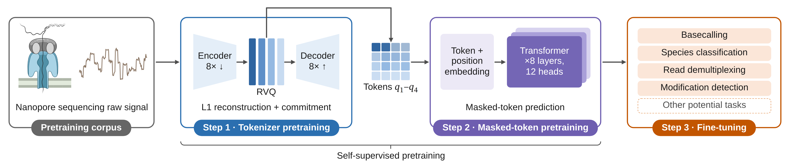

<h2 align="center">
   
  A foundation model for raw nanopore signal through discrete tokenization
</h2>

<!-- Enable once the repository is public and the package is on PyPI:

-->

## Overview

Nanopore sequencing reads nucleic acids as changes in ionic current that carry
information beyond the base sequence. Self-supervised pretrained models have advanced
genomic sequence modeling and single-cell analysis, but remain underexplored for raw
nanopore signals, which are continuous and lack a native token vocabulary.

**Brieno** combines reconstruction-based tokenization through residual vector
quantization with a transformer for contextual representation learning. The transformer
is pretrained with masked-token prediction on signals from **118 million reads**.

  

With frozen or fine-tuned features, the model:

- identifies **species** without requiring reference genomes;
- outperforms Dorado in **native-barcode demultiplexing**;
- matches Dorado's **basecalling** performance on bacteriophage lambda;
- approaches Dorado's specialized model on **DNA methylation** calling.

Pretraining also improves the use of contextual information and generalization across
sequencing runs. Together, these findings support self-supervised pretraining as a basis
for transferable representations of raw nanopore signals.

## Name origin

*Brieno* is a shortened form of [*Brienomyrus*](https://en.wikipedia.org/wiki/Brienomyrus), a genus of weakly electric fishes that
communicate through patterns of electric pulses — reading meaning from an electrical
signal rather than from a written sequence.

## Status

This repository is the public home of Brieno. Code, pretrained weights and usage
instructions are being prepared for release and will be added here. The manuscript
describing the method is currently under review.

## Topics

Nanopore sequencing · self-supervised learning · foundation models · raw signal
representation learning · vector quantization · species identification · metagenomics ·
DNA methylation

## Citation

Citation details will be added once the manuscript is available. Until then, please
refer to this repository.

## License

Released under the [Apache License 2.0](LICENSE).
